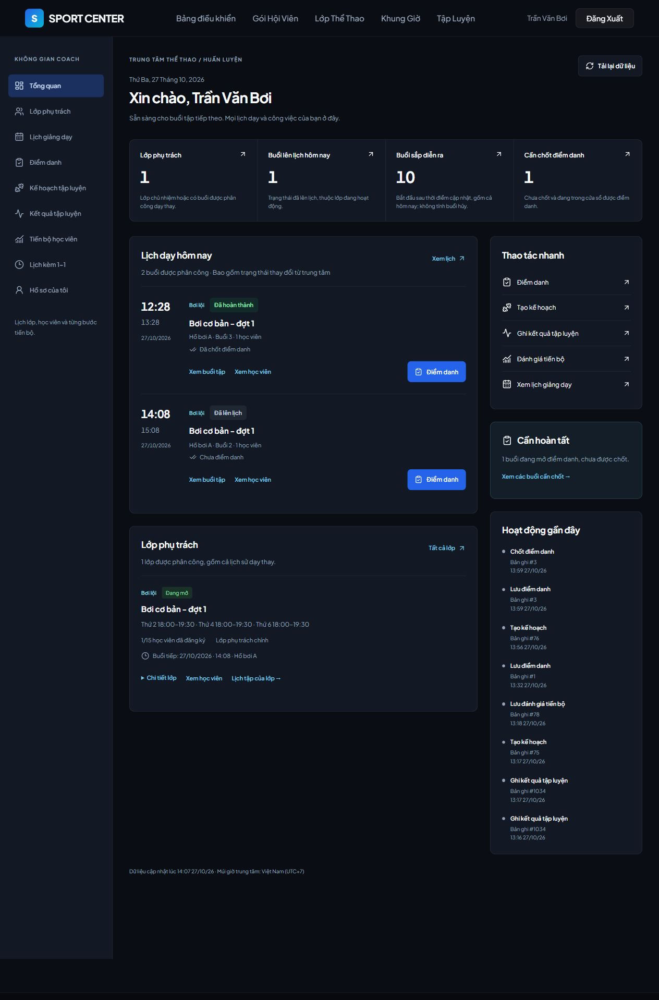
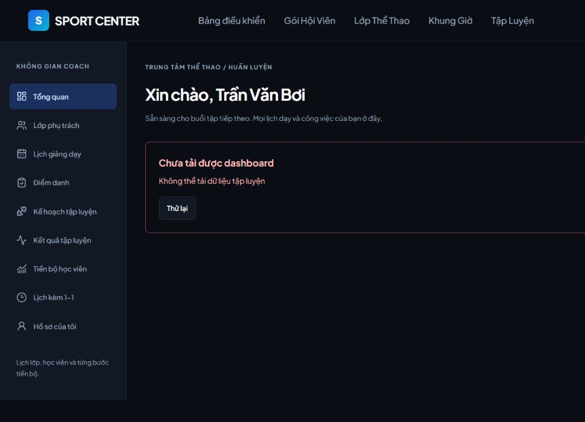

# Coach Dashboard — 27/10/2026

## Kết quả

Cải tiến trang `/coach` hiện có thành dashboard của huấn luyện viên, dùng dữ liệu Flow 2 và Flow 4. Không thay cơ chế đăng nhập, không tạo dashboard trùng, không thêm tính năng AI.

Dashboard gồm tên Coach, ngày tại Việt Nam, bốn thống kê, lịch hôm nay, lớp được phân công, năm thao tác nhanh và tám hoạt động Flow 4 gần nhất. Có trạng thái tải, rỗng, lỗi/thử lại và đăng nhập lại khi API trả 401. Sidebar dùng chung với màn huấn luyện, chọn mục theo URL, chuyển thành thanh cuộn ngang trên mobile.

## Định nghĩa số liệu

| Chỉ số | Cách tính |
| --- | --- |
| Lớp phụ trách | Lớp có Coach chủ nhiệm là người đăng nhập hoặc có ít nhất một buổi phân công cho người đó. Bao gồm lịch sử dạy thay và lớp đã kết thúc/hủy; giao diện hiển thị trạng thái rõ ràng. |
| Buổi lên lịch hôm nay | Buổi của Coach, ngày tại Asia/Ho_Chi_Minh, trạng thái SCHEDULED; loại lớp DRAFT/CANCELED. Buổi DONE không còn trong số này nhưng vẫn xuất hiện ở danh sách hôm nay. |
| Buổi sắp diễn ra | SCHEDULED, giờ bắt đầu sau thời điểm cập nhật; loại lớp DRAFT/CANCELED. Gồm cả hôm nay, không giới hạn 30 ngày. |
| Cần chốt điểm danh | Chưa có attendance_finalized_at và được phép sửa theo quy tắc Flow 4: SCHEDULED/DONE, lớp không DRAFT/CANCELED, từ 15 phút trước bắt đầu đến 48 giờ sau kết thúc. Lưu điểm danh chưa làm giảm số này; chốt mới giảm. |

Số học viên của từng buổi dùng đăng ký hợp lệ vào giờ bắt đầu và các bản điểm danh đã tồn tại, loại người từ chối buổi bù hoặc rời lớp trước buổi đó. Số học viên trên thẻ lớp là số người đăng ký REGISTERED hiện tại. Hai số có ý nghĩa khác nhau.

Trạng thái điểm danh phân biệt chưa đánh dấu, đã lưu/chưa chốt, đã chốt và buổi hủy. Buổi đã chốt vẫn có thể sửa trong cửa sổ Flow 4 hiện có. Danh sách hôm nay hiển thị cả buổi đã hoàn thành/hủy để Coach thấy thay đổi lịch.

## Routes và điều hướng

| URL | Chức năng |
| --- | --- |
| `/coach` | Tổng quan; chỉ COACH được truy cập |
| `/coach?view=classes` | Lớp phụ trách, chi tiết lớp, học viên và lịch lớp |
| `/coach?view=attendance` | Các buổi chưa chốt đang trong cửa sổ điểm danh |
| `/coach?view=profile` | Hồ sơ từ `/api/users/me`, chỉ xem |
| `/coach?view=slots` | Danh sách lịch kèm 1-1 hiện có |
| `/coach/training?tab=sessions` | Lịch và điểm danh hiện có |
| `/coach/training?tab=sessions&session=3` | Mở trực tiếp một buổi; backend kiểm tra quyền sở hữu |
| `/coach/training?tab=sessions&classId=1` | Lọc lịch theo lớp |
| `/coach/training?tab=sessions&status=completed` | Các buổi DONE để ghi kết quả |
| `/coach/training?tab=sessions&status=scheduled` | Các buổi đã lên lịch trong khoảng ngày đang xem |
| `/coach/training?tab=plans&create=plan` | Mở form tạo kế hoạch hiện có |
| `/coach/training?tab=progress&classId=1` | Theo dõi học viên, chọn sẵn lớp |

ID trong bảng là ví dụ URL, không được hardcode vào giao diện. Chọn buổi, tab, lớp và trạng thái qua URL nên reload vẫn mở đúng mục. Khoảng ngày của lịch vẫn theo màn Flow 4: mặc định ±30 ngày, cho phép chọn khoảng tối đa 366 ngày. Vì vậy số buổi trong lịch không nhất thiết bằng chỉ số sắp diễn ra trên dashboard.

LoginPage đã có chuyển hướng đúng và được giữ nguyên: MANAGER → `/manager`, RECEPTIONIST → `/receptionist`, COACH → `/coach`, MEMBER → `/member`. Project hiện không có cơ chế nhớ URL trước đăng nhập. AuthContext tiếp tục lưu token và nạp `/api/users/me` khi reload. PrivateRoute chặn vai trò khác tại frontend; backend kiểm tra độc lập.

HLV dạy thay xem danh sách học viên qua buổi được phân công. Chỉ HLV chủ nhiệm lớp mới được mở lịch sử cả lớp, tạo kế hoạch hoặc đánh giá. Sidebar không có thao tác quản trị.

## API

### API mới

`GET /api/coach/training/dashboard`

Không nhận Coach ID từ client. Lấy email từ Authentication, xác nhận tài khoản COACH đang hoạt động, truy vấn theo user ID đó.

Response `CoachDashboardResponse`:

```text
today, refreshedAt
summary: myClasses, todaySessions, upcomingSessions, pendingAttendance
todaySessions[], pendingSessions[]:
  session, sport, members, marked,
  attendanceEditable, finalizationAllowed, resultsEditable
classes[]:
  id, coachId, name, sport, course, description, status, capacity, members,
  schedule, nextSession, representativeSessionId
recentActivities[]:
  id, action, resourceId, occurredAt, finalized
```

Dùng TrainingService/TrainingRepository hiện có, quy tắc sửa attendance và results hiện có. Metadata được nạp theo lô; không gọi API hoặc JDBC riêng cho từng lớp/buổi. Lịch tiếp theo dùng LATERAL join; đếm tương lai độc lập với khoảng lịch. Activity lấy audit_logs theo chính actor và danh sách hành động Flow 4 cho phép, chỉ trả metadata cần hiển thị, không trả payload nhạy cảm.

Không cần migration mới cho dashboard. Database vẫn phải có migrations Flow 4 **06 rồi 07**. Index coach/date đã nằm trong migration 06; dùng lại index và quan hệ Flow 2, không thêm fixture vào migration.

### API tái sử dụng

- `GET /api/users/me`: tên, vai trò, hồ sơ Coach qua AuthContext.
- `GET /api/coach/training/classes`: lớp dùng trong các form Flow 4.
- `GET /api/coach/training/classes/{id}/members`: học viên lớp chủ nhiệm.
- `GET /api/coach/training/classes/{classId}/members/{memberId}` và `/history/{kind}`: tiến bộ và lịch sử.
- `GET /api/coach/training/sessions`, `GET /sessions/{id}`: lịch và chi tiết buổi.
- `PUT /api/coach/training/sessions/{id}/attendance`: lưu/chốt điểm danh.
- `PUT /api/coach/training/sessions/{id}/results`: ghi kết quả.
- `GET/POST /api/coach/training/plans`, `GET/PUT /plans/{id}`: kế hoạch.
- `POST /api/coach/training/evaluations`, `PUT /evaluations/{id}`: đánh giá.
- `GET /api/coach/slots/me`, `POST /api/coach/slots/{id}/cancel`: giữ phần lịch 1-1 cũ, sửa mapping thời gian startAt/endAt và body reason theo backend. Không thêm module đặt lịch mới.

## Các file thuộc thay đổi dashboard

Đường dẫn dưới đây tương đối với hai repository trong `D:/SWP_Khoa`.

### Backend — SportCenterManagementSystem_V2

- `src/main/java/com/swp391/sportcentermanagementsystem_v2/dto/responseDTO/CoachDashboardResponse.java`: DTO mới.
- `src/main/java/com/swp391/sportcentermanagementsystem_v2/controller/CoachTrainingController.java`: aggregate endpoint.
- `src/main/java/com/swp391/sportcentermanagementsystem_v2/service/TrainingService.java`: tổng hợp dashboard và dùng lại quyền/quy tắc Flow 4.
- `src/main/java/com/swp391/sportcentermanagementsystem_v2/repository/TrainingRepository.java`: thống kê, metadata theo lô, lớp và audit.
- `src/test/java/com/swp391/sportcentermanagementsystem_v2/service/TrainingServiceTest.java`: biên cửa sổ điểm danh.
- `src/test/java/com/swp391/sportcentermanagementsystem_v2/integration/TrainingIntegrationTest.java`: dữ liệu thực, phân quyền và cập nhật.
- `docs/COACH_DASHBOARD.md`, `docs/screenshots/coach-dashboard-*.jpg`: tài liệu và ảnh test.

### Frontend — fe_swp_SportCenterV2

- `src/pages/coach/CoachDashboard.jsx`: cải tiến dashboard hiện có.
- `src/components/coach/CoachLayout.jsx`, `src/css/coach/CoachDashboard.module.css`: layout và responsive.
- `src/pages/coach/CoachSlots.jsx`: tách phần lịch 1-1 cũ.
- `src/pages/training/CoachTraining.jsx`: dùng layout và query params để mở đúng chức năng.
- `src/pages/training/CoachProgress.jsx`: nhận lớp chọn sẵn.
- `src/pages/training/useTrainingData.js`, `src/services/trainingService.js`: giữ HTTP status cho lỗi 401 và thử lại.
- `src/services/coachService.js`: không che lỗi lịch 1-1 thành danh sách rỗng; gửi đúng lý do hủy.
- `src/App.jsx`: `/coach` chỉ COACH.
- `src/components/common/Navbar.jsx`: link Coach Dashboard và className cho style riêng phần Coach.
- `docs/coach-dashboard/PRODUCT.md`, `DESIGN.md`, `README.md`: phạm vi sản phẩm, quy tắc giao diện và hướng dẫn.

Các thay đổi Flow 4 trước dashboard và thay đổi khác đang có trong working tree không bị reset/ghi đè. Nhiều file Flow 4 vẫn là untracked trong repository hiện tại; cần đưa các file phụ thuộc này vào cùng bản bàn giao.

## Kiểm thử ngày 27/10/2026

### Tự động

- `mvn -Dtest=TrainingServiceTest,TrainingIntegrationTest test`: **68/68 pass**, gồm 34 unit và 34 integration; 7 integration dashboard và 4 ca biên unit mới.
- Backend compile: pass.
- Frontend `npm run build`: pass.
- Frontend `npm run lint`: exit 0, còn **17 cảnh báo ở code cũ**, không có cảnh báo mới từ dashboard.
- Toàn bộ backend `mvn test`: **197/199 pass**, 1 failure AuthServiceTest kỳ vọng `Invalid email or password` nhưng service trả `Account is locked`; 1 error `contextLoads` không kết nối được database mặc định để lấy JDBC metadata. Integration Flow 4 dùng DB riêng và vẫn pass. Không sửa module Auth hay test khởi động ngoài phạm vi dashboard.

Integration dùng `FLOW4_TEST_DB_URL`, `FLOW4_TEST_DB_USER`, `FLOW4_TEST_DB_PASSWORD`; PostgreSQL riêng với schema và migrations 04–07. Test rollback, không chạy trên DB nhóm. Log: `C:/Users/tdinh/AppData/Local/Temp/coach-dashboard-tests.log` và `coach-dashboard-all-tests.log`.

Các ca dashboard kiểm tra: số liệu thuộc đúng Coach; buổi tương lai xa hơn 30 ngày; hủy buổi không còn đếm; không có lớp; lưu khác chốt; dạy thay không được mở lịch sử lớp; activity chỉ của actor; 401 khi JWT hết hạn; 403 với Member/Manager/Receptionist; không tin `coachId` do client truyền; biên -15 phút và +48 giờ.

### Trình duyệt

Đã kiểm tra Coach đăng nhập → `/coach`; reload còn phiên; lớp → học viên chọn sẵn; lối tắt tạo kế hoạch → lưu nháp → activity dashboard xuất hiện; điểm danh → lưu → chốt → pending giảm 2 xuống 1; lối tắt kết quả lọc DONE; hồ sơ và trạng thái rỗng lịch 1-1; API ngừng → lỗi/thử lại; API trả 401 → đăng nhập lại; Member về `/member` và không được vào `/coach`; Manager đăng nhập về `/manager` với bảng tài khoản tải được; Receptionist về `/receptionist` với danh sách hội viên tải được. Responsive được kiểm tra ở 1280px, tablet 820px và mobile 390px, không tràn ngang dashboard. Viewport đã khôi phục sau test.

Ảnh là **dữ liệu kiểm thử**:





## Chạy demo và giới hạn

- Frontend đang chạy tại `http://127.0.0.1:5173`; API tại `http://127.0.0.1:18080`.
- UI dùng database cô lập `scms_flow4_fix_ui_20261027` trên PostgreSQL `127.0.0.1:55436`, không phải database nhóm.
- Coach: `coach01@test.local`; Member: `member001@test.local`. Đây chỉ là tài khoản test local; dùng mật khẩu được cấu hình riêng trong môi trường kiểm thử, không lưu mật khẩu trong repository.
- Để kiểm tra lịch hôm nay, session 2 và 3 chưa có attendance được chuyển về 27/10 trong DB UI test; session 3 đã được lưu/chốt bằng UI, có một kế hoạch nháp mới. Mật khẩu Manager/Receptionist chỉ trong DB test được đặt cùng mật khẩu để kiểm tra chuyển hướng. Không có fixture trong mã giao diện hoặc migration.
- Các dịch vụ scheduler bị tắt trong launcher test để tránh thay đổi fixture theo ngày. Môi trường nhóm chạy theo cấu hình bình thường của project.
- Dashboard cập nhật khi mở lại hoặc bấm Tải lại dữ liệu; chưa có realtime/polling. Hồ sơ chỉ xem. Hoạt động giới hạn tám bản ghi mới nhất. Danh sách lớp chưa phân trang; chưa có kiểm thử tải lớn.
- Không mở rộng AI, bài tập về nhà, export hay quyền override điểm danh cho Manager/Receptionist trong nhiệm vụ này.
