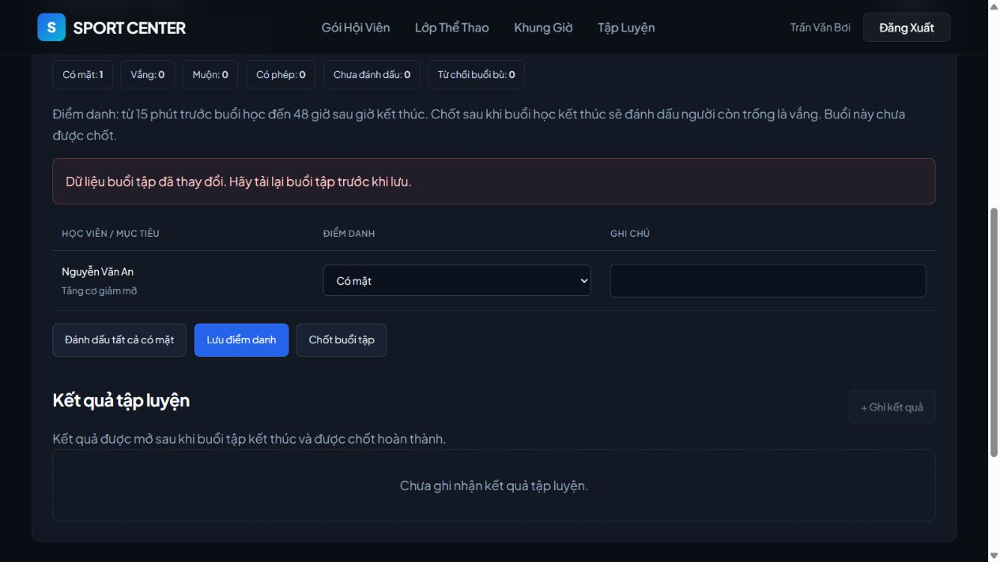
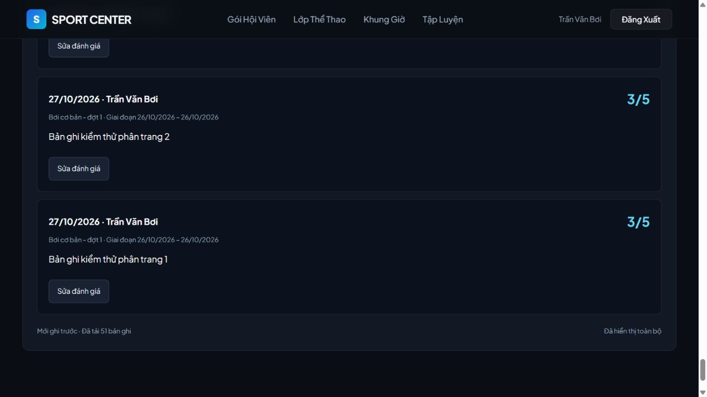
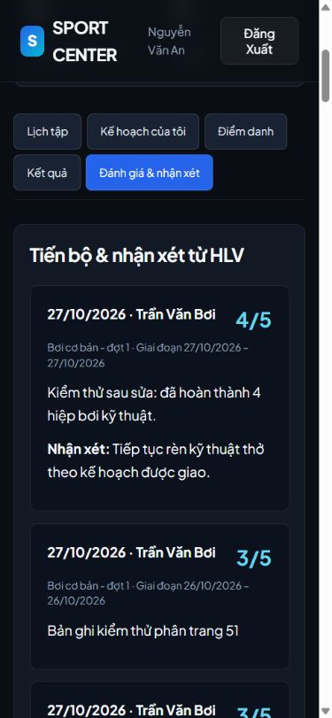

# Flow 4 — Kết quả sửa lỗi audit, 27/10/2026

## Phạm vi và trạng thái

Đã sửa sáu lỗi được xác nhận trong full audit theo yêu cầu “SỬA LUÔN”. Các luồng Coach → attendance/finalization/results, giao kế hoạch → Member xem và đánh giá → Member xem đã được kiểm tra lại. Không commit hay triển khai; DB nhóm chưa bị thay đổi. Báo cáo audit trước sửa tại `D:/SWP_Khoa/audit-flow4-2026-10-27/REPORT.md` được giữ nguyên.

## Các lỗi đã sửa

| ID | Thay đổi | File chính |
| --- | --- | --- |
| F4-01 | Xét khoảng đăng ký bao phủ giờ bắt đầu, thay vì chỉ thấy một enrollment đã hủy. Roster dùng member ID kể cả trước lần điểm danh đầu. Quy tắc dùng chung cho lịch sử, thống kê và quyền xem kế hoạch lịch sử. | TrainingRepository.java |
| F4-02 | Chỉ session SCHEDULED/DONE và attendance hợp lệ được tính counts/thống kê, kể cả hoạt động hoàn thành. Giữ attendance của buổi đã hủy, trả trạng thái/lý do để UI ghi rõ không tính thống kê. | TrainingRepository.java, TrainingService.java, TrainingResponse.java, TrainingShared.jsx, CoachSession.jsx |
| F4-03 | Quan hệ lịch sử theo lớp bao gồm đánh giá và kế hoạch cá nhân đã có; học viên rời lớp không làm mất quyền đọc/sửa đánh giá của đúng tác giả còn phụ trách lớp. Giao mới kế hoạch cá nhân vẫn cần đăng ký hiện tại. | TrainingRepository.java |
| F4-04 | Thêm session training_version; PUT attendance/results bắt buộc gửi version đã đọc. So version sau khóa class → session; tăng cùng transaction với dữ liệu/audit. Tab cũ nhận 409, UI có Tải lại buổi tập. | v3_07_flow4_revision.sql, DTOs, TrainingRepository.java, TrainingService.java, CoachSession.jsx |
| F4-05 | Deserializer riêng cho các trường số Flow 4, chỉ nhận JSON số nguyên; từ chối số thập phân/chuỗi, kiểm tra range như trước. | TrainingNumbers.java, TrainingRequest.java |
| F4-06 | Thay giới hạn ngầm 1.000 bằng cursor ID giảm dần, limit+1 để xác định tiếp nối. Mỗi trang kiểm tra actor/role/ownership. UI có Tải thêm, số đã tải, trạng thái hết/lỗi và hủy request khi unmount. | TrainingRepository.java, TrainingService.java, controllers/DTOs, PagedRecords.jsx và các màn Coach/Member |

Đường dẫn Java nằm dưới `src/main/java/com/swp391/sportcentermanagementsystem_v2/`; frontend nằm trong repository `fe_swp_SportCenterV2/src/pages/training/`.

## Hợp đồng API mới

- `Session.version` là revision chung của điểm danh và kết quả trong buổi, bắt đầu từ 0. Gửi lại trường `version` trong PUT attendance/results. Thành công thì đọc lại session; lỗi 409 thì tải lại trước khi áp thay đổi tiếp.
- Sửa plan/evaluation tiếp tục dùng version riêng bắt đầu từ 1.
- GET coach plans và các danh sách lịch sử trả `{ "items": [...], "nextCursor": 123 }`. `nextCursor: null` nghĩa là hết. Dashboard/MemberHistory chứa trang đầu 50 bản ghi cho mỗi danh sách.
- Trang sau gửi nguyên cursor từ response và `limit` (mặc định 50, từ 1 đến 100); cursor phải dương. ID giảm dần bảo đảm bản ghi mới chèn không làm xê dịch các trang đã tải. Muốn thấy dữ liệu mới, chọn Tải lại.
- Thống kê luôn tính toàn bộ dữ liệu đủ điều kiện, độc lập số trang đã tải. Date filter của dashboard áp dụng cho lịch buổi tập, không cắt lịch sử.

| GET | kind hợp lệ |
| --- | --- |
| `/api/coach/training/plans?cursor=&limit=` | Kế hoạch của Coach |
| `/api/coach/training/classes/{classId}/members/{memberId}/history/{kind}?cursor=&limit=` | attendance, results, evaluations |
| `/api/member/training/history/{kind}?cursor=&limit=` | plans, attendance, results, evaluations; danh tính Member từ JWT |

## Kiểm thử tự động

| Kiểm tra | Kết quả |
| --- | --- |
| TrainingServiceTest | 30 qua, 0 fail/error/skip |
| TrainingIntegrationTest, PostgreSQL 18 riêng | 27 qua, 0 fail/error/skip |
| Tổng Flow 4 | **57/57 qua** |
| Toàn backend | **187/188 qua**, 1 failure sẵn có, 0 error/skip |
| Frontend `npm run build` | Qua |
| Frontend `npm run lint` | Exit 0; 20 warnings sẵn có ngoài Flow 4 |
| Migration 07 áp và chạy lại | Qua trên DB kiểm thử riêng |

Lỗi toàn suite còn lại: `AuthServiceTest.inactiveAccountAndUnknownEmailGetTheSameMessageAsWrongPassword`, expected `Invalid email or password`, actual `Account is locked`. AuthService/test này không bị sửa trong Flow 4. Không tuyên bố toàn bộ backend suite xanh.

Mười integration test hồi quy mới:

1. `canceledRegistrationDoesNotInvalidateAValidReregistration`
2. `reregistrationAfterSessionDoesNotRestoreInvalidEarlyAttendance`
3. `centerCancellationExcludesEarlyMarksButKeepsReadableHistory` — gọi ClassDisruptionService thật.
4. `canceledSessionAlsoExcludesPresentAndCompletedActivitiesFromStatistics`
5. `evaluationRemainsAccessibleToCoachAfterMemberLeavesWithoutAttendance`
6. `staleAttendanceAndFinalizationCannotOverwriteAnotherTab`
7. `staleResultCannotOverwriteNewerValuesOrAttendance`
8. `fractionalNumbersAndMissingRevisionAreRejectedAtHttpBoundary` — qua MockMvc/JSON thật.
9. `cursorPagesReachBeyondOneThousandResultsAndPreserveMemberScope` — đi hết 1.001 kết quả, không trùng và không lộ dữ liệu tài khoản khác.
10. `plansEvaluationsAndAttendanceAllExposeStableContinuation`

Integration dùng DB riêng đã nạp schema/migrations, dữ liệu test rollback. Hướng dẫn chạy và các biến `FLOW4_TEST_DB_*` nằm trong [tài liệu module](FLOW4_TRAINING_ATTENDANCE.md#6-kiểm-thử-và-chạy). Nếu không cung cấp URL test, integration bị skip rõ ràng; không dùng DB nhóm để chạy test.

Log gốc trên máy kiểm thử:

- `C:/Users/tdinh/AppData/Local/Temp/flow4-fix-tests.log`
- `C:/Users/tdinh/AppData/Local/Temp/flow4-fix-all-tests.log`

## Kiểm tra UI sau sửa

Chạy frontend/backend ở cổng riêng và PostgreSQL test port 55436; UI dùng bản clone kiểm thử `scms_flow4_fix_ui_20261027`. Không chèn fixture vào migration hoặc frontend.

| Kịch bản | Quan sát |
| --- | --- |
| Học viên có enrollment cũ CANCELED và lần REGISTERED mới hợp lệ | Lưu điểm danh rồi đọc lại vẫn có quyền sửa, counts đúng |
| Hai tab cùng version; tab B lưu LATE rồi tab A lưu bản cũ | Tab A hiển thị lỗi dữ liệu đã đổi; Tải lại giữ LATE của tab B |
| Chốt sau giờ kết thúc | Hiện xác nhận, session DONE, mở ghi kết quả |
| Tạo rồi sửa kết quả cùng activity | Hiển thị một record với 4 hiệp, 8 lần lặp, 600 giây; Member xem đúng sau tải lại |
| Coach giao kế hoạch cả lớp, một bài tập | Member thấy đúng tên, mục tiêu, hướng dẫn và chỉ tiêu |
| Coach lưu đánh giá 4/5 | Member thấy đúng summary và nhận xét |
| Coach Tải thêm | Từ 50 lên đủ 51 đánh giá fixture, báo Đã hiển thị toàn bộ |
| Member Tải thêm sau thêm một đánh giá mới | Từ 50 lên đủ 52, có bản cuối, báo Đã hiển thị toàn bộ |
| Member mobile 390px | Các tab xếp dòng, summary/nhận xét đọc được; đã reset viewport sau kiểm tra |

Ảnh là dữ liệu test:

## Áp dụng lên môi trường nhóm

1. Database đã có schema_v3, migration 04 và 05: áp migration 06 nếu chưa có, tiếp theo **[v3_07_flow4_revision.sql](../database/v3_07_flow4_revision.sql)**. Nếu đã áp 06 thì chỉ cần 07. Migration 07 không có fixture, thêm cột version mặc định 0.
2. Chạy frontend/backend cùng bản thay đổi này; client cũ thiếu version hoặc mong danh sách dạng array sẽ không tương thích.
3. Sau khi chạy, dùng tài khoản Coach/Member của môi trường demo kiểm tra lịch → điểm danh → chốt → kết quả và kế hoạch/đánh giá → Member xem.

Đợt sửa này chỉ áp migration trên DB test. Giữ quy tắc 15 phút trước đến 48 giờ sau cho sửa attendance; không thêm quyền override của Manager/Receptionist hay tính năng AI. Chưa có export hoặc lịch sử toàn bộ mọi phiên bản kế hoạch. Kiểm thử hai tab xác nhận stale replay; chưa thực hiện stress test đồng thời tải lớn.
