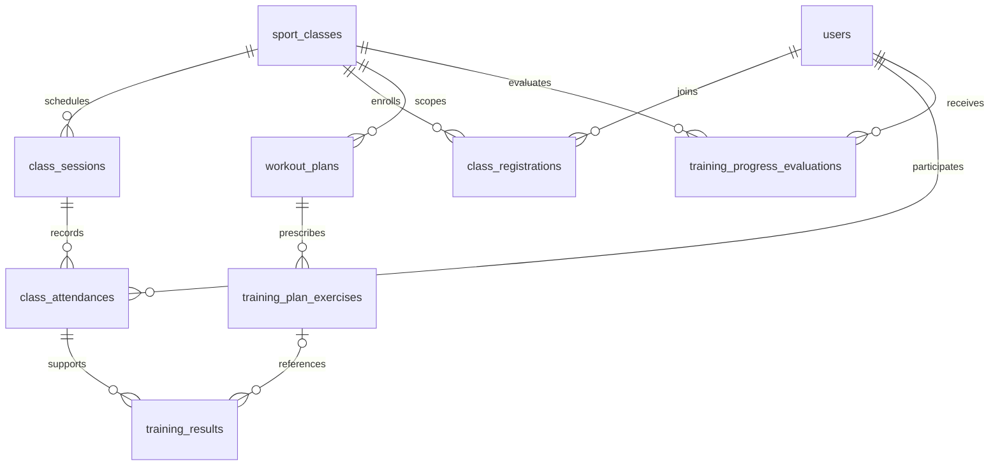

# Flow 4 — Training and Attendance Management

## 1. Kiến trúc và tích hợp

Backend Java 21 / Spring Boot 3.4.4 / Spring Security JWT / JPA / PostgreSQL. Frontend React 19 / Vite / React Router / CSS Modules ở repository `fe_swp_SportCenterV2`. Giữ kiến trúc controller → service → repository, DTO request/response và exception handler hiện có.

Flow 4 dùng `JdbcTemplate`, theo convention assessment, notification và audit. Không tạo entity trùng users, class, enrollment, session, attendance hay workout plan. Migration là SQL thủ công, không thêm Flyway.

- Flow 1: dùng users/roles/member_profiles, JWT và trạng thái tài khoản hoạt động.
- Flow 2: dùng sport_classes, class_sessions và class_registrations; không sinh lịch mới. Coach của session có thể khác coach của class.
- Giữ DECLINED_MAKEUP phục vụ từ chối buổi bù/hoàn tiền. Không thay đổi payment, subscription hoặc booking.
- `workout_progress` tiếp tục lưu chỉ số thể lực của assessment. `class_evaluations` tiếp tục xếp loại A/B/C/D cuối khóa và cấp voucher. Đánh giá định kỳ Flow 4 dùng bảng riêng.
- Không triển khai AI hoặc check-in lễ tân. `facility_attendances` và điểm danh tham gia lớp là hai sự kiện khác nhau.

## 2. Quy tắc

### Quyền truy cập

- SecurityConfig giới hạn `/api/coach/training/**` cho COACH; Member chỉ GET `/api/member/training` và `/api/member/training/**`. Service kiểm tra lại role, active và ownership của tài nguyên, kể cả từng trang lịch sử.
- Điểm danh/kết quả theo coach của từng **session**, kể cả dạy thay. Session detail trả kế hoạch đã giao phù hợp ngày và roster để coach dạy thay cũng ghi kết quả theo bài có sẵn.
- Tạo kế hoạch, xem toàn bộ lịch sử học viên theo lớp, đánh giá định kỳ theo coach của **class**. Sửa kế hoạch/đánh giá cần đúng tác giả và còn phụ trách class. Tác giả vẫn đọc được kế hoạch của mình sau khi đổi HLV; không còn quyền sửa khi đã mất phân công.
- Member được lấy ID từ JWT. Không có API đọc dữ liệu người khác bằng memberId do client truyền. Kế hoạch cá nhân chỉ đúng Member được nhận; draft/archived không xuất hiện ở Member.
- Sau khi rời lớp, Member chỉ xem kế hoạch cả lớp có khoảng ngày bao phủ session mà mình đã có điểm danh (không tính từ chối buổi bù); không được xem kế hoạch cho những buổi tương lai chỉ vì từng học lớp đó.
- Không tự cấp quyền điểm danh cho Manager/Receptionist khi chưa có phân quyền cụ thể.

### Điểm danh

- Eligible là `REGISTERED` trước hoặc đúng giờ bắt đầu; không dùng PENDING_PAYMENT/WAITLISTED.
- Roster gồm eligible hiện tại và người đã có attendance. Khi enrollment LEFT/CANCELED sau đó, các record cũ vẫn đọc và chỉnh hợp lệ được. Nếu đã rời lớp và chưa có attendance, không suy đoán lịch sử thanh toán để tạo điểm danh mới.
- Nếu đã điểm danh sớm nhưng enrollment bị LEFT/CANCELED trước hoặc đúng giờ bắt đầu (theo canceled_at), bản ghi chỉ còn để tra cứu: khóa sửa/ghi kết quả, không tính counts/tỷ lệ/buổi hoàn thành và không tạo quyền xem kế hoạch cả lớp. UI ghi rõ lý do. Rời lớp sau giờ bắt đầu vẫn giữ quyền chỉnh lịch sử trong cửa sổ hợp lệ.
- Cửa sổ sửa: **15 phút trước giờ bắt đầu đến 48 giờ sau giờ kết thúc**, tính cả hai đầu, múi giờ Asia/Ho_Chi_Minh.
- Chỉ SCHEDULED/DONE trong class không DRAFT/CANCELED. PROPOSED và CANCELED_BY_CENTER bị khóa.
- Chưa đánh dấu là null, không tự thành ABSENT. Lưu thường không chốt.
- Chốt sau giờ kết thúc: người chưa đánh dấu thành ABSENT, session chuyển DONE và ghi attendance_finalized_at. Sau đó vẫn sửa được trong cửa sổ còn lại.
- DECLINED_MAKEUP không bị ghi đè/chuyển thành vắng và không tính vào tỷ lệ tham gia.
- Unique session/member, PUT upsert; bulk tối đa 500 entry, trùng member trong payload bị từ chối. Kiểm tra toàn bộ trước khi ghi; các ghi, chốt và audit trong cùng transaction.
- Khóa theo thứ tự **class → session**, phối hợp với Flow 2 để tránh race với hủy lớp, đổi coach và enrollment.
- Enrollment cũ đã hủy không vô hiệu hóa lần đăng ký lại hợp lệ: chỉ khóa vì rời trước buổi khi không có khoảng đăng ký nào bao phủ thời điểm bắt đầu. Dùng cùng quy tắc cho roster, lịch sử, thống kê và quyền xem kế hoạch lịch sử.
- Session có `version` bắt đầu từ 0. PUT attendance/results bắt buộc gửi version vừa đọc; kiểm tra sau khi khóa class → session, tăng version cùng transaction sau mỗi lần lưu. Tab cũ nhận 409 và phải tải lại. Version này dùng chung cho cả điểm danh, chốt và kết quả của buổi.

### Kế hoạch và kết quả

- Kế hoạch mới luôn có class scope. member_id null là cả lớp, có member_id là cá nhân. Giao mới cho cá nhân cần REGISTERED trong lớp phụ trách. Assignment bất biến; muốn đổi đối tượng thì tạo kế hoạch khác. Kế hoạch đã giao vẫn sửa/lưu trữ được khi người nhận rời lớp dù chưa có attendance; chuyển lại sang PUBLISHED cần kiểm tra enrollment hiện tại.
- Tiêu đề/mục tiêu/ngày bắt đầu/ngày kết thúc bắt buộc; end ≥ start; 1–100 bài tập. Status DRAFT/PUBLISHED/COMPLETED/ARCHIVED.
- Chuyển sang PUBLISHED gửi notification trong ứng dụng cho đúng Member hoặc các Member REGISTERED của lớp, cùng transaction. Không gửi email ra bên ngoài.
- ID bài tập ổn định; bỏ bài chỉ retire, không xóa. Giữ nguyên content JSON và is_ai_generated cũ, không tự chuyển đổi dữ liệu legacy.
- Plan và evaluation dùng optimistic version; PUT phải gửi version vừa đọc.
- Kết quả chỉ sau giờ kết thúc của session DONE, class không canceled, attendance PRESENT/LATE. Khi có kết quả, không được đổi participation sang ABSENT/EXCUSED.
- Bài theo kế hoạch dùng activityKey `exercise:<id>`; bài ngoài kế hoạch dùng mã ổn định, ví dụ `warmup-01`. Unique attendance/activityKey, gửi lại cùng mã cập nhật cùng record; không đổi exercise link của record đã có.
- Exercise liên kết phải đúng class/member, đã PUBLISHED/COMPLETED, chưa retired khi ghi mới và plan bao phủ ngày session. Tên bài liên kết được lấy từ DB.
- Lần đầu ghi lưu snapshot JSON bài được giao, planId/version. Sửa kết quả chỉ đổi phần thực tế/nhận xét. Sửa kế hoạch, retire bài hoặc rời lớp không làm mất snapshot/kết quả.
- Số nguyên không âm: sets ≤ 10.000; repetitions ≤ 100.000; durationSeconds ≤ 604.800. **Thời lượng luôn dùng giây**. Completion COMPLETED/PARTIAL/NOT_COMPLETED.
- Numeric DTO của Flow 4 chỉ nhận JSON số nguyên; từ chối số thập phân, chuỗi số và giá trị vượt kiểu/range bằng 400, không âm thầm cắt phần lẻ. Không thay cấu hình JSON của các flow khác.

### Đánh giá và thống kê

- Đánh giá định kỳ theo class, rating 1–5; periodStart ≤ periodEnd ≤ evaluationDate ≤ hôm nay. Member hiện tại hoặc có lịch sử của lớp; đúng tác giả mới sửa.
- Tỷ lệ tham gia = (PRESENT + LATE) / (PRESENT + LATE + ABSENT + EXCUSED). Không có mẫu số trả null và UI hiển thị `—`. Số liệu lấy từ DB, không dựng số mẫu. Thống kê tính toàn bộ lịch sử.
- Chỉ session SCHEDULED/DONE và attendance hợp lệ được tính thống kê, gồm cả số hoạt động hoàn thành; session đã hủy giữ lịch sử/lý do để tra cứu nhưng không cộng số liệu. Session detail đã hủy trả các counts bằng 0.
- Quan hệ lịch sử của học viên gồm attendance, đánh giá hoặc kế hoạch cá nhân đã có. Coach còn phụ trách class vẫn đọc/sửa đánh giá của mình sau khi học viên rời lớp dù chưa từng điểm danh; không mở quyền giao mới kế hoạch cá nhân cho học viên đã rời.

## 3. Database

Chạy `database/v3_06_flow4_training_attendance.sql` sau schema_v3, v3_04 và v3_05, rồi chạy **`database/v3_07_flow4_revision.sql`**. Migration 07 thêm `class_sessions.training_version bigint NOT NULL DEFAULT 0`. Cả hai migration chạy lại được, có transaction, không chứa dữ liệu demo. Không tự áp schema khi app chạy (`ddl-auto=none`). Backend mới cần migration 07 trước khi khởi động; triển khai frontend/backend cùng phiên bản vì hợp đồng danh sách đã đổi sang Page.

| Bảng | Thay đổi / quan hệ |
| --- | --- |
| class_sessions | Thêm attendance_finalized_at (06), training_version (07) |
| class_attendances | recorded_at/updated_at; giữ unique session/member; FK session đổi CASCADE thành RESTRICT để ngăn xóa lịch sử |
| workout_plans | class_id FK, objective, coach_notes, version; member_id nullable cho cả lớp; legacy cá nhân vẫn hợp lệ |
| training_plan_exercises | FK plan; thứ tự, nội dung, chỉ tiêu, retired |
| training_results | FK attendance/exercise tùy chọn; unique attendance/activityKey; prescription snapshot, actual values, tác giả/timestamps |
| training_progress_evaluations | FK class/member/coach; kỳ, ngày, rating, nhận xét, version |

Các bảng mới có PK identity, FK, CHECK thời gian/số lượng/trạng thái và index theo scope truy vấn.



Lưu ý psql: schema_v3.sql đặt search_path rỗng. Import dump rồi chạy migration bằng **lệnh psql riêng**, hoặc SET search_path TO public giữa dump và migration. Backup DB nhóm trước khi áp migration.

## 4. API

Authorization Bearer JWT; ngày yyyy-MM-dd. DTO `TrainingRequest.java` / `TrainingResponse.java` là hợp đồng chi tiết. Version response phải gửi lại khi PUT plan/evaluation và attendance/results. Session version bắt đầu từ 0; plan/evaluation từ 1.

| Method | Endpoint | Chức năng |
| --- | --- | --- |
| GET | /api/coach/training/classes | Lớp có phân công class/session |
| GET | /api/coach/training/classes/{classId}/members | Roster hiện tại + lịch sử, chỉ class coach |
| GET | /api/coach/training/classes/{classId}/members/{memberId} | Mục tiêu, attendance/results/evaluations trong đúng class |
| GET | /api/coach/training/classes/{classId}/members/{memberId}/history/{kind}?cursor=&limit= | Trang tiếp theo: attendance, results hoặc evaluations; kiểm tra lại class ownership |
| GET | /api/coach/training/sessions?from=&to= | Lịch mặc định ±30 ngày, tối đa 366 ngày |
| GET | /api/coach/training/sessions/{id} | Session, roster, counts, khả năng sửa, kết quả, plan phù hợp |
| PUT | /api/coach/training/sessions/{id}/attendance | version, entries[{memberId,status,notes}], finalizeSession boolean |
| PUT | /api/coach/training/sessions/{id}/results | Upsert hoạt động của người tham gia; version bắt buộc |
| GET | /api/coach/training/plans?cursor=&limit= | Page kế hoạch do coach tạo |
| GET | /api/coach/training/plans/{id} | Chi tiết plan có quyền |
| POST | /api/coach/training/plans | Tạo plan và exercises |
| PUT | /api/coach/training/plans/{id} | Sửa có version, retire bài bị bỏ |
| POST | /api/coach/training/evaluations | Tạo nhận xét định kỳ |
| PUT | /api/coach/training/evaluations/{id} | Sửa đúng tác giả, có version |
| GET | /api/member/training?from=&to= | Dashboard của tài khoản hiện tại |
| GET | /api/member/training/history/{kind}?cursor=&limit= | Page plans/attendance/results/evaluations của Member từ JWT |

Các danh sách kế hoạch và lịch sử trả `{ "items": [...], "nextCursor": 123 }`; `nextCursor: null` nghĩa là hết. Dashboard/MemberHistory chứa trang đầu (50 bản ghi) cho từng danh sách. Thứ tự ID giảm dần, cursor lấy từ response, limit mặc định 50, chấp nhận 1–100; cursor phải dương. Không còn giới hạn ngầm 1.000 dòng. Thống kê vẫn tính toàn bộ dữ liệu, không phụ thuộc các trang đã tải. Bộ lọc ngày áp dụng cho lịch buổi tập; lịch sử dùng cursor riêng.

Lỗi theo project: 400 validation/date query, 401 thiếu/sai JWT, 403 role/ownership, 404 resource không tồn tại, 409 business/version conflict. Không trả JPA graph/password/thông tin liên lạc trong dữ liệu tập luyện.

## 5. Frontend

- `/coach/training`: lịch/filter ngày/lớp/trạng thái/tìm kiếm → session → điểm danh hàng loạt/ghi chú → chốt có xác nhận → ghi/sửa kết quả; tạo/sửa plan nhiều bài; lịch sử và đánh giá member theo class.
- Màn hình tiến bộ vẫn cho chọn lớp đã hủy để đọc lịch sử; chỉ hiện nút sửa đánh giá do chính HLV đang đăng nhập tạo. Form sửa kế hoạch giữ rõ tên người nhận đã rời lớp. Nút chốt điểm danh dùng finalizationAllowed từ server, chỉ mở sau giờ kết thúc.
- `/member/training`: thống kê thật, lịch, kế hoạch cá nhân/cả lớp, attendance, results, feedback.
- Navbar có Tập Luyện; dashboard cũ có nút vào module để dùng cả khi link Navbar ẩn trên mobile. Routes chỉ COACH/MEMBER.
- Loading/error/empty states, chặn gửi lặp, khóa form theo khả năng sửa, reload sau lưu, AbortController chống response cũ khi đổi lựa chọn. Không biến lỗi server thành danh sách trống.
- Có Tải lại dữ liệu/Tải lại buổi tập/Tải lại lịch sử. Lỗi version hiển thị yêu cầu tải lại trước khi lưu. `PagedRecords` có Tải thêm, số bản ghi đã tải, trạng thái hết dữ liệu, lỗi/thử tải lại; hủy request khi đổi màn hình.
- Palette/font hiện có, CSS Modules, form responsive, vùng cuộn bảng riêng, labels, focus rõ, role=alert cho lỗi. Không hardcode sample data.

## 6. Kiểm thử và chạy

Backend cần JDK 21/Maven/PostgreSQL đã áp migration và biến môi trường hiện có, đặc biệt JWT_SECRET. Không thay secret project.

```powershell
# Tại repository backend
mvn test -Dtest=TrainingServiceTest

# Integration opt-in: database test riêng đã nạp schema + migrations.
$env:FLOW4_TEST_DB_URL='jdbc:postgresql://127.0.0.1:55436/scms_flow4_test'
$env:FLOW4_TEST_DB_USER='flow4_test'
$env:FLOW4_TEST_DB_PASSWORD=''
mvn test -Dtest=TrainingIntegrationTest

# Tại repository frontend
npm ci
npm run build
npm run lint
```

Integration dùng seed snapshot schema_v3, clock cố định 2026-11-07, PostgreSQL thật, JWT thật, MockMvc; rollback test data, mock scheduler để tránh tác vụ nền. **Không trỏ vào DB nhóm.** Không có FLOW4_TEST_DB_URL thì integration test được skip rõ ràng; unit vẫn chạy.

Vite mặc định proxy về localhost:8080; có thể đặt SCMS_API_TARGET=http://localhost:18080 để thử backend cổng riêng. CORS_ALLOWED_ORIGINS backend cần khớp origin frontend.

### Kết quả

- Migration áp và chạy lại thành công trên PostgreSQL 18 riêng.
- **30 unit tests Flow 4 qua**: ownership/role/active, cửa sổ thời gian từng giây, chốt sớm, canceled/proposed, duplicate payload, eligibility, declined makeup, lịch sử, participation và validation.
- **27 integration tests Flow 4 qua**: JWT/API role/ownership/privacy, lưu/đọc/upsert, version, snapshot, unique/FK RESTRICT, rollback và 10 test hồi quy cho sáu lỗi audit. Có thử hủy session qua ClassDisruptionService thật, tab cũ, numeric HTTP validation và đọc đủ 1.001 kết quả qua cursor.
- Sau sửa ngày 27/10/2026: **188 tests toàn project, 187 qua, 1 fail sẵn có**, `AuthServiceTest.inactiveAccountAndUnknownEmailGetTheSameMessageAsWrongPassword`: expected `Invalid email or password`, actual `Account is locked`. AuthService/test này không bị sửa bởi Flow 4. **57/57 tests Flow 4 qua, không skip, không error**, gồm 30 unit và 27 integration trên PostgreSQL 18 riêng.
- Frontend production build qua; lint không lỗi, module mới không có warning. Warning sẵn có của AuthContext/ToastContext/dashboard cũ vẫn còn.
- Kiểm tra giao diện trực tiếp với đăng nhập thật và DB riêng: Coach lưu/chốt attendance, giao/sửa plan (gồm ngày), ghi/sửa cùng result, tạo evaluation; Member xem schedule, plan, attendance, result đã cập nhật và feedback. Desktop 1366px, mobile 390px; không tràn ngang toàn trang, bảng có vùng cuộn riêng.
- Ảnh dữ liệu kiểm thử: [Coach desktop](screenshots/flow4-coach-desktop.jpg), [Member desktop](screenshots/flow4-member-desktop.jpg), [Member mobile](screenshots/flow4-member-mobile.jpg). Dữ liệu này chỉ ở DB kiểm thử, không được chèn vào migration hay UI production.

## 7. File thay đổi

Backend (các package dưới src/main/java/com/swp391/sportcentermanagementsystem_v2):

- database/v3_06_flow4_training_attendance.sql
- database/v3_07_flow4_revision.sql
- config/TrainingConfig.java; config/SecurityConfig.java (thêm rule)
- controller/CoachTrainingController.java; controller/MemberTrainingController.java
- dto/requestDTO/TrainingRequest.java; dto/requestDTO/TrainingNumbers.java; dto/responseDTO/TrainingResponse.java
- repository/TrainingRepository.java; service/TrainingService.java
- src/test/java/com/swp391/sportcentermanagementsystem_v2/service/TrainingServiceTest.java
- src/test/java/com/swp391/sportcentermanagementsystem_v2/integration/TrainingIntegrationTest.java
- docs/FLOW4_TRAINING_ATTENDANCE.md
- docs/screenshots/flow4-coach-desktop.jpg; flow4-member-desktop.jpg; flow4-member-mobile.jpg
- docs/screenshots/flow4-audit-history-desktop.jpg; flow4-audit-history-mobile.jpg; flow4-audit-member-desktop.jpg

Frontend:

- src/pages/training/: CoachTraining.jsx, CoachSession.jsx, CoachProgress.jsx, TrainingPlanEditor.jsx, MemberTraining.jsx, TrainingShared.jsx, PagedRecords.jsx, trainingUtils.js, useTrainingData.js
- src/services/trainingService.js; src/css/training/Training.module.css
- src/App.jsx; src/components/common/Navbar.jsx
- src/pages/coach/CoachDashboard.jsx; src/pages/member/MemberDashboard.jsx (nút vào module)
- vite.config.js (proxy target tùy chọn, mặc định giữ nguyên); FLOW4.md

## 8. Giới hạn / phụ thuộc

- Cần áp migration thủ công trên DB nhóm trước khi dùng; DB nhóm chưa bị thay đổi.
- Danh sách có cursor và Tải thêm, chưa có export. Dữ liệu mới thêm trong lúc tải trang cần Tải lại để xuất hiện; lịch có filter tối đa 366 ngày.
- Plan legacy chưa có class scope/bài tập chuẩn hóa vẫn đọc được cho Member nếu published; tạo plan Flow 4 mới để quản lý đầy đủ. Không đoán mapping JSON legacy.
- Attendance/results dùng version chung của buổi: thay đổi bất kỳ điểm danh/kết quả nào làm version cũ xung đột; người dùng tải lại rồi áp thay đổi. Plan/evaluation có version riêng. Đây không phải lưu toàn bộ lịch sử các phiên bản kế hoạch.
- Không tự cấp quyền mở lại attendance sau 48 giờ; cần định nghĩa quy trình/quyền riêng nếu nhóm muốn sửa muộn.
- Các lỗi sẵn có ở MemberDashboard về shape subscription/voucher hoặc nhãn enrollment/slot thuộc flow khác. Trang training fetch trực tiếp API riêng, có đường dẫn độc lập.

## 9. Kết quả sau sửa sáu lỗi audit ngày 27/10/2026

| Yêu cầu | Kết quả đối chiếu |
| --- | --- |
| 4.1 Lịch HLV | Lịch/lớp/phòng/HLV từ Flow 2; roster và quyền theo phân công class/session |
| 4.2 Điểm danh | Bốn trạng thái; bulk/upsert; cửa sổ thời gian; chốt sau giờ kết thúc; phân biệt chưa đánh dấu; lịch sử và thống kê |
| 4.3 Kế hoạch | Cá nhân/cả lớp; bài tập; ngày; trạng thái; version; bảo toàn exercise ID/snapshot |
| 4.4 Kết quả | Chỉ người đã tham gia buổi DONE; kiểm tra liên kết bài, đơn vị, số không âm; cập nhật không tạo bản trùng |
| 4.5 Đánh giá | Lịch sử trong đúng lớp; kỳ/ngày/rating; nhận xét; chỉ đúng tác giả và phân công mới được sửa |
| 4.6 Dashboard Member | Lịch/kế hoạch/điểm danh/kết quả/đánh giá/thống kê thật; danh tính lấy từ JWT |

Full audit sau lần rà soát ban đầu xác nhận sáu lỗi. Cả sáu đã được sửa theo yêu cầu tiếp theo của người dùng:

| ID | Đã sửa | Bằng chứng hồi quy |
| --- | --- | --- |
| F4-01 | Xác định khoảng đăng ký bao phủ buổi; lần hủy cũ không khóa lần đăng ký lại hợp lệ | Đăng ký lại trước/sau buổi; lưu rồi mở lại trên UI |
| F4-02 | Loại session đã hủy khỏi counts và mọi thống kê liên quan; giữ lịch sử/lý do | ClassDisruptionService thật; PRESENT, EXCUSED và hoạt động đã hoàn thành |
| F4-03 | Giữ quyền truy cập lịch sử theo đánh giá/kế hoạch cá nhân khi học viên rời lớp | Đánh giá có trước attendance vẫn đọc/sửa được bởi đúng tác giả |
| F4-04 | Version chung của session, kiểm tra sau khóa và tăng cùng transaction; tab cũ trả 409 | Stale attendance, chốt, result và xung đột chéo; hai tab UI |
| F4-05 | Parse số nguyên nghiêm ngặt riêng Flow 4 | MockMvc với số thập phân/chuỗi và thiếu version trả 400 |
| F4-06 | Cursor pagination và Tải thêm cho lịch sử/kế hoạch | Đọc đủ 1.001 kết quả; tiếp nối các loại lịch sử; UI Coach 51 và Member 52 đánh giá |

**57/57 tests Flow 4 qua** (30 unit + 27 integration), toàn project 187/188 qua với duy nhất lỗi Auth đã nêu. Frontend build qua; lint exit 0, còn 20 cảnh báo sẵn có ngoài Flow 4. Migration 07 đã áp và chạy lại trên DB kiểm thử riêng; DB nhóm chưa bị thay đổi.

Trình duyệt sau sửa: Coach lưu/mở lại/chốt attendance cho học viên đăng ký lại; tab cũ bị chặn và tải lại khôi phục trạng thái mới; tạo/sửa kết quả giữ một bản ghi; giao kế hoạch có bài tập; tạo đánh giá; tải thêm đủ lịch sử. Member đăng nhập riêng xem đúng kế hoạch, điểm danh, kết quả đã sửa và nhận xét, giữ dữ liệu sau Tải lại. Mobile 390px hiển thị được nội dung và các tab.

Chi tiết thay đổi, test và triển khai: [FLOW4_FIXES_2026-10-27.md](FLOW4_FIXES_2026-10-27.md). Báo cáo audit ban đầu ở `D:/SWP_Khoa/audit-flow4-2026-10-27/REPORT.md` được giữ nguyên làm snapshot trước sửa.

Ảnh sau sửa: [Xung đột hai tab](screenshots/flow4-fix-conflict.jpg), [Tải đủ lịch sử Coach](screenshots/flow4-fix-coach-pagination.jpg), [Kết quả Member](screenshots/flow4-fix-member-results.jpg), [Nhận xét Member mobile](screenshots/flow4-fix-member-mobile.jpg).

**Kết luận phạm vi:** sáu nhóm 4.1–4.6 có luồng thực và sáu lỗi xác nhận đã có sửa/test hồi quy. Chạy migration 07 sau 06 và triển khai frontend/backend cùng phiên bản trước demo trên môi trường nhóm. Không suy rộng kết quả này thành bảo đảm không còn lỗi trong mọi tình huống.
