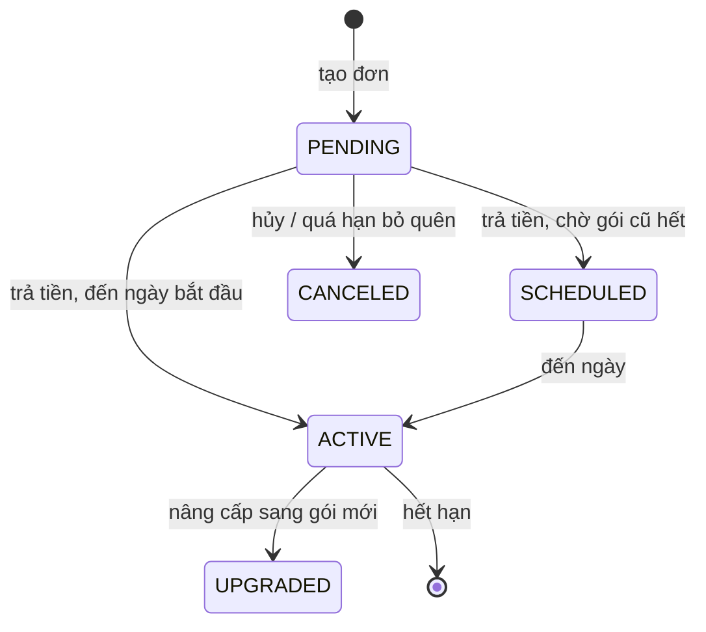
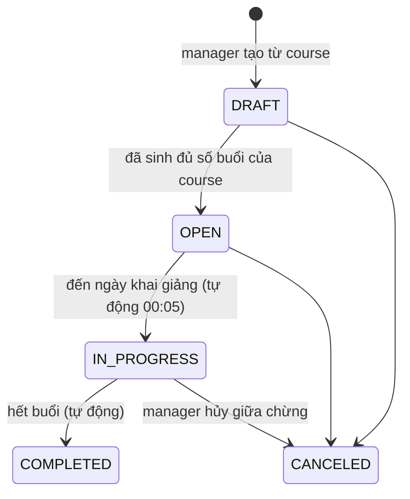
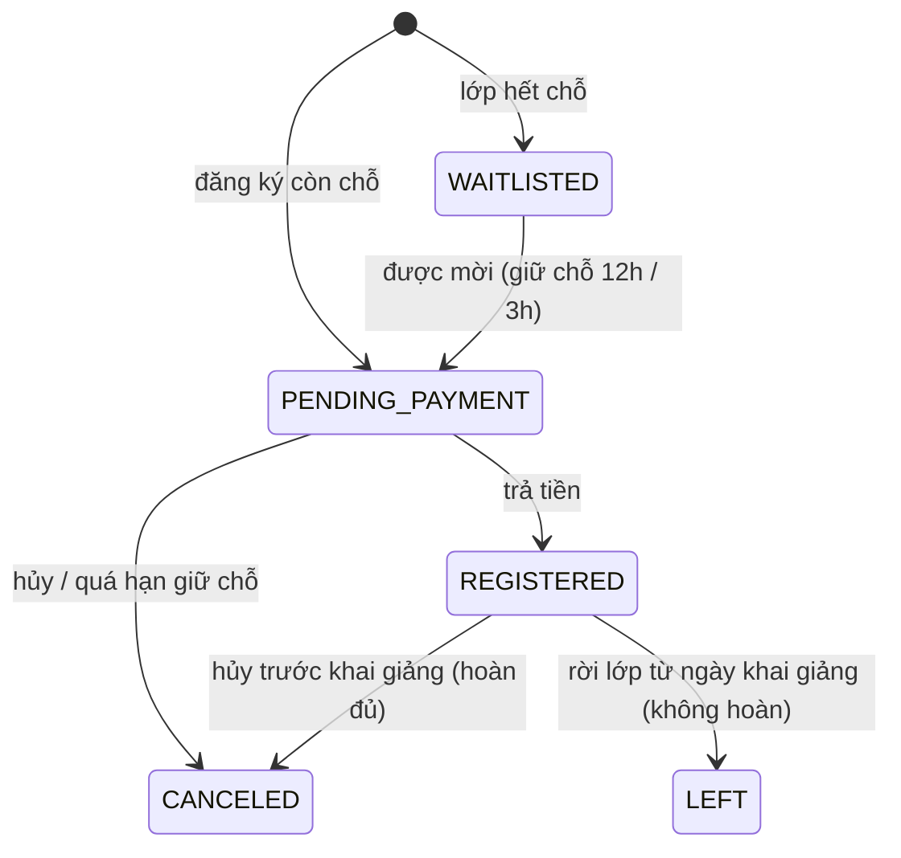
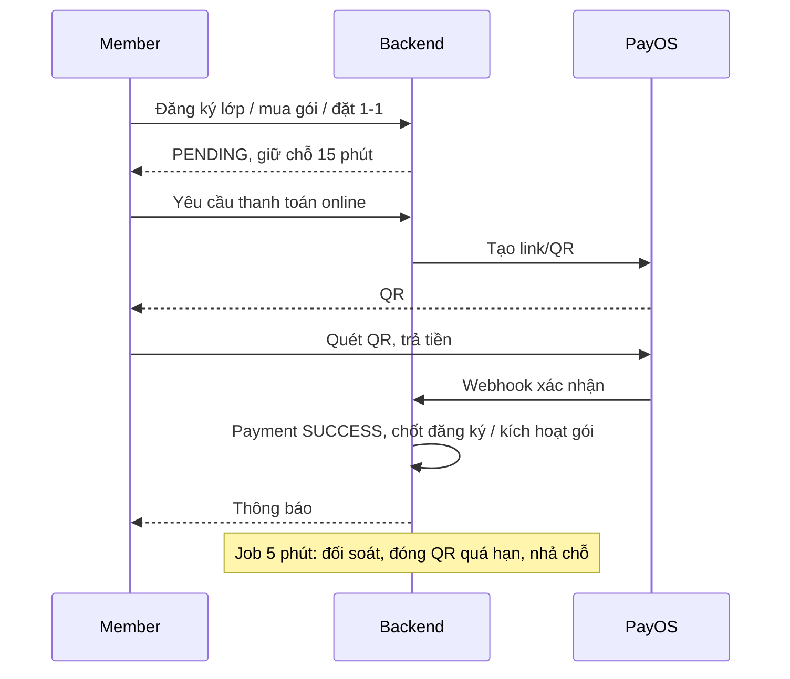
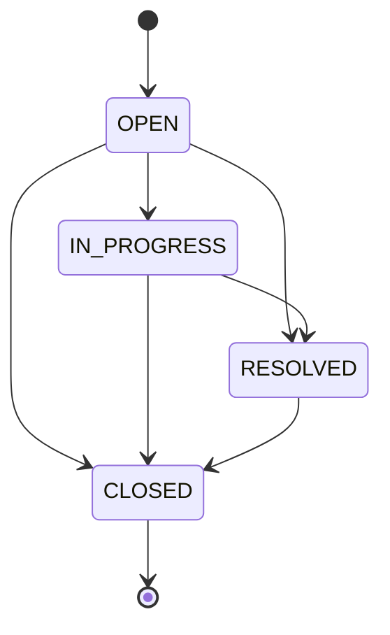

# Tổng hợp chức năng, business rule và flow – Sports Center Management System

Tài liệu tổng hợp từ code BE (`SportCenterManagementSystem_V2`) và FE (`fe_swp_SportCenterV2`). Mã luật `BR-xxx` là mã ghi trong comment của code. Giá trị con số (15 phút, 24 giờ, 8/15/25%...) nằm trong bảng `system_settings`, manager chỉnh được một số mục.

Bốn vai trò: **Manager**, **Coach**, **Member**, **Receptionist**.

---

## 1. Flow 1 – Tài khoản và gói thành viên (bắt buộc)

### Chức năng
| Vai trò | Chức năng |
|---|---|
| Ai cũng có | Đăng ký, xác thực email, đăng nhập, quên/đặt lại mật khẩu, xem/sửa hồ sơ, đổi mật khẩu |
| Member | Xem gói, mua / gia hạn / nâng cấp / hủy gói, xem gói của mình và trạng thái gói, nhận thông báo sắp hết hạn |
| Receptionist | Tìm hội viên, tạo hội viên tại quầy, mua / gia hạn / nâng cấp / hủy gói giúp hội viên |
| Manager | Tạo/sửa/ẩn gói thành viên, tạo/sửa/khóa/mở tài khoản nhân sự, xem quyền (chỉ xem) |

### Business rule
- **BR-ACC-04/06/07** (cấu hình): mã/link xác thực email sống 1440 phút; đặt lại mật khẩu 30 phút; gửi lại email xác thực cách nhau tối thiểu 60 giây, tối đa 5 lần/ngày.
- Mật khẩu băm BCrypt. Nhập sai mật khẩu hiện tại khi đổi mật khẩu tính chung bộ đếm với đăng nhập sai. Đăng nhập báo lỗi giống nhau dù sai email hay sai mật khẩu (không lộ email nào đã đăng ký).
- Gói thành viên: mã gói luôn IN HOA, tên không trùng. Gói đã bán **không đổi quyền lợi** vì quyền lợi được chụp vào `benefits_snapshot` lúc mua (BR-PKG-05). Đổi trạng thái gói dùng API riêng, không đi qua API sửa thông tin.
- Mua dài hạn được giảm theo số tháng: 1–2 tháng 0%, 3–5 tháng 8%, 6–11 tháng 15%, 12 tháng 25% (BR-PRC-01).
- Tổng tiền gói = giá tháng × số tháng − giảm dài hạn − credit nâng cấp.
- Loại đơn: `NEW`, `RENEWAL`, `UPGRADE`. Đơn mới chỉ ở `PENDING`, chưa tính ngày bắt đầu/kết thúc cho tới khi trả tiền.
- Không đăng ký mới khi đang có gói dùng hoặc gói đã trả đang chờ kích hoạt. Chưa hỗ trợ nâng cấp khi đang có gói chờ.
- **Nâng cấp:** credit = giá trị gói cũ × số ngày còn lại / tổng số ngày. Gói đã hết hạn không nâng cấp được. Giá trị gói cũ gồm tiền đã trả + credit của lần nâng cấp trước.
- Gói nhắc hết hạn ở các mốc 3 ngày và 1 ngày (BR-PKG-12). Đơn `PENDING` bị bỏ quên sẽ tự hủy để hội viên không bị kẹt "đã có đơn chờ".
- Tiền mặt chỉ nhận số tiền > 0. Không tự tạo giao dịch miễn phí.

### Vòng đời gói (`member_subscriptions`)

---

## 2. Flow 2 – Đặt lớp và quản lý lịch (bắt buộc)

### Chức năng
| Vai trò | Chức năng |
|---|---|
| Manager | Quản lý môn thể thao, khóa học (course), phòng, khung giờ; tạo lớp, đặt lịch tuần, sinh buổi học, mở đăng ký, hủy lớp; phân công/ thay coach; gán môn cho phòng và coach; duyệt yêu cầu 1-1 và xử lý sự cố của buổi 1-1; hủy buổi, xếp buổi bù, hoàn tiền thay buổi bù; phòng bảo trì; coach nghỉ tạm / nghỉ việc |
| Member | Xem danh mục lớp, đăng ký / hủy lớp, vào danh sách chờ, xem lịch cá nhân (timetable), gửi yêu cầu nhiều buổi 1-1, trả tiền một lần, dời lịch buổi 1-1, báo không đi được buổi bù, xem đánh giá cuối lớp |
| Coach | Xem lịch dạy, đánh giá cuối lớp từng học viên (A/B/C/D) |
| Receptionist | Đăng ký hoặc hủy lớp giúp hội viên, thu tiền mặt (lớp, gói, yêu cầu 1-1) |

### Vòng đời lớp (`sport_classes`)

### Business rule – lớp và lịch
- **BR-CLS-01/03:** lớp tạo ở `DRAFT` từ một course; học phí để trống thì lấy mặc định của course. Buổi học sinh từ lịch tuần, đánh số từ ngày khai giảng.
- **BR-CLS-03/04:** lịch tuần chỉ sửa khi còn nháp. Đã có ghi danh thì lịch tuần bị khóa (DB chặn). Từ ngày khai giảng không sửa thông tin lớp nữa. Đổi phòng/coach của một buổi được, nhưng ngày giờ giữ nguyên (muốn dời thì hủy buổi rồi xếp bù).
- **BR-SCH-01:** hai buổi của cùng coach hoặc cùng phòng bị coi là trùng nếu chồng giờ **hoặc cách nhau dưới 15 phút**. Hai khung giờ cũng phải cách nhau tối thiểu 15 phút.
- **BR-SCH-02/04:** phòng đang hoạt động, đúng môn, đủ sức chứa. Coach phải có vai trò COACH, đang hoạt động, dạy đúng môn của course.
- **BR-SCH-03:** member không được trùng giờ giữa lớp đã ghi danh và suất 1-1 khác. Khi trùng, báo rõ trùng với lớp nào.
- **BR-SCH-05:** phòng chuyển sang bảo trì/đóng cửa thì các buổi chưa diễn ra được đổi sang phòng khác.
- **BR-CRS-02 / BR-CLS-07:** khóa nâng cao: mọi lần đăng ký đều phải xác nhận đã đọc cảnh báo (khóa tiên quyết cùng môn, cấp thấp hơn).
- **BR-CLS-08:** cuối lớp coach chấm từng học viên A/B/C/D kèm nhận xét, mỗi đăng ký một đánh giá.

### Business rule – đăng ký lớp
- **BR-ENR-01:** không cần có gói thành viên, chỉ cần là MEMBER đang hoạt động.
- **BR-ENR-02:** hạn ghi danh đến ngày khai giảng.
- **BR-ENR-03:** đăng ký xong ở trạng thái `PENDING_PAYMENT`, **giữ chỗ 15 phút** (`payment.hold_minutes`). Quá hạn và chưa có thanh toán đang xử lý thì tự nhả chỗ (job chạy mỗi 5 phút).
- **BR-ENR-06:** lễ tân ghi danh hộ theo đúng các luật như member tự đăng ký.
- **BR-CAN-01:** hủy chưa trả tiền → hủy luôn. Đã trả: hủy **trước ngày khai giảng hoàn đủ**; **từ ngày khai giảng** là rời lớp (`LEFT`), không hoàn.
- **BR-CAN-02:** manager hủy lớp: đăng ký chưa trả thì hủy; đã trả thì hoàn đủ nếu chưa khai giảng, giữa chừng hoàn theo số buổi chưa học; các buổi chưa diễn ra thành `CANCELED_BY_CENTER`.

### Danh sách chờ
- **BR-WL-01:** lớp hết chỗ thì vào danh sách chờ **miễn phí**, cùng điều kiện mở ghi danh.
- **BR-WL-02:** thứ tự mời: hạng gói cao trước, cùng hạng thì vào trước. Hạng chốt lúc vào chờ.
- **BR-WL-03:** có chỗ trống thì mời người đầu danh sách, chuyển sang `PENDING_PAYMENT` có hạn **12 giờ**; còn dưới 3 ngày đến khai giảng thì **3 giờ**. Trùng giờ với lớp/1-1 họ có sau khi vào chờ thì bỏ qua, họ vẫn ở lại hàng chờ.
- **BR-WL-04:** đến ngày khai giảng danh sách chờ đóng.

### Buổi học bị hủy do trung tâm và buổi bù
- **BR-MKP-01:** manager hủy một buổi do lỗi trung tâm; học viên **không bị tính vắng**.
- **BR-MKP-02:** hệ thống đề xuất tối đa **3 ngày bù** gần nhất sau buổi cuối của lớp, kèm số học viên bị trùng giờ. Manager chọn ngày thì mới tạo buổi bù; ngày chọn được kiểm lại bằng đúng luật đề xuất.
- **BR-MKP-03:** học viên không đi được buổi bù thì bấm "không đi được", ghi `DECLINED_MAKEUP` và **được hoàn một buổi** (học phí đã trả chia cho số buổi gốc).
- **BR-MKP-04:** hủy cả lớp thì các buổi chưa diễn ra thành `CANCELED_BY_CENTER`.
- **BR-MKP-05:** coach nghỉ tạm: các buổi trong khoảng ngày bị hủy rồi xếp bù như thường. Coach nghỉ việc hẳn: manager thay coach giữa lớp (coach mới phải dạy đúng môn); buổi 1-1 sắp tới đã trả tiền thì tìm coach thay, không có thì chuyển sang chờ xếp lại để member chọn coach và giờ mới.
- **BR-MKP-06:** ngày bù cách buổi bị hủy quá **30 ngày** thì không bù, hoàn một buổi cho mọi học viên đã ghi danh (làm lại không hoàn trùng).
- **BR-MKP-07:** số buổi bị hủy vượt **30%** thì học viên được rời lớp.

### Buổi 1-1 với coach
- **BR-ONE-02:** giá 1 giờ chung cho mọi coach (mặc định 300.000, cấu hình `one_on_one.hourly_price`). Giá = giá giờ × số phút / 60, làm tròn đến đồng. Đổi giá thì lần đặt sau theo giá mới, suất đã đặt giữ giá cũ.
- **BR-ONE-03:** duyệt yêu cầu thì các suất được tạo và giữ chỗ cho member trong lúc chờ thanh toán (3 giờ, xem BR-ONE-07); quá hạn tự nhả.
- **BR-ONE-04 (dời lịch):** buổi đã trả tiền của yêu cầu dời được sang ngày và khung giờ khác nếu member báo trước **từ 24 giờ** (`one_on_one.reschedule_before_hours`), không giới hạn số lần, không mất buổi, không hoàn tiền; buổi mới giữ giá và đơn của buổi cũ. Báo muộn hơn hoặc vắng không báo thì mất buổi. Member không tự hủy từng buổi đã trả.
- **BR-ONE-05 (sự cố từ trung tâm):** ưu tiên giữ buổi. Phòng hỏng thì đổi phòng cùng giờ; coach bận thì đổi coach rảnh đúng giờ (giá chung nên không đổi); không đổi được thì chuyển buổi sang "chờ xếp lại": member dời được bất cứ lúc nào trước giờ học, không bị giới hạn 24 giờ. Hoàn tiền phần của buổi đó chỉ là bước cuối khi hoàn toàn bất khả thi, do manager quyết định. Không còn suất 1-1 lẻ: buổi 1-1 chỉ sinh ra từ yêu cầu đã duyệt.
- **BR-ONE-01:** DB cấm đổi coach trên suất đã có người đặt, nên khi thay coach, lượt đặt được chuyển sang dòng suất mới.
- **BR-ONE-06 (yêu cầu nhiều buổi):** member xin N buổi với một coach, cùng khung giờ mỗi tuần, liên tiếp (tối đa 12 buổi, cấu hình `one_on_one.max_sessions_per_request`). Buổi đầu phải cách lúc gửi ít nhất 48 giờ (`one_on_one.request_min_lead_hours`). Yêu cầu quá 24 giờ chưa được duyệt thì tự hết hạn (`one_on_one.request_expire_hours`).
- **BR-ONE-07 (duyệt cả chuỗi):** manager duyệt cả chuỗi hoặc từ chối kèm lý do, không duyệt từng phần. Một buổi vướng (coach bận, hết phòng, member trùng lịch) thì cả yêu cầu không duyệt được. Duyệt xong các suất được tạo và giữ chỗ cho member, member trả tiền một lần cho cả chuỗi trong 3 giờ (`one_on_one.request_pay_hours`), quá hạn thì các suất được nhả và không mở lại thành suất trống. Coach chỉ nhận thông báo khi chuỗi đã được trả tiền.
- **BR-ONE-08 (thanh toán của yêu cầu):** đơn của yêu cầu nằm ở buổi sớm nhất và có tổng tiền cả chuỗi (ưu đãi tier tính một lần trên tổng). Trung tâm hủy một buổi (bước cuối của BR-ONE-05) thì hoàn phần chia đều của buổi đó.
- **Giá:** một giá giờ chung cho mọi coach (`one_on_one.hourly_price`), không còn hạng coach.

---

## 3. Flow 3 – Thanh toán, hoàn tiền, báo cáo (bắt buộc)

### Chức năng
| Vai trò | Chức năng |
|---|---|
| Member | Thanh toán online qua PayOS (QR), xem lịch sử thanh toán, hóa đơn, các khoản hoàn tiền, xem giá trước khi trả |
| Receptionist | Thu tiền mặt, xem/in hóa đơn, xem và xử lý khoản chờ hoàn tiền |
| Manager | Báo cáo doanh thu, thành viên, lớp, tổng quan, việc cần làm; nhật ký thao tác; xem mọi khoản hoàn |

### Business rule
- **BR-PAY-05 / BR-BEN-01:** giá sau ưu đãi: giảm theo phần trăm = giá gốc × % / 100, làm tròn HALF_UP về đồng. Ưu đãi duy nhất là giảm theo hạng (tier), chỉ áp cho lớp và buổi 1-1; gói không có giảm thêm. Hệ thống không còn voucher.
- **BR-QR-02:** mã QR sống tối đa 15 phút, hết hạn cùng lúc hạn giữ chỗ. Chỗ mời từ danh sách chờ giữ lâu hơn (BR-WL-03).
- **BR-PAY-04:** thu tiền mặt thì QR còn mở phải được đóng trước.
- **BR-QR-04:** tiền về muộn (đã hết hạn giữ chỗ): còn chỗ và lớp còn mở thì kích hoạt lại; không thì payment chuyển sang chờ hoàn tiền.
- **BR-RFD-02/03:** hoàn tiền theo cách đã trả (`CASH` hoặc `TRANSFER`). Người xử lý bấm "đã hoàn" sau khi đã trả; hệ thống ghi **ai** và **lúc nào**. Hoàn kết thúc việc mua thì payment `PENDING_REFUND` → `REFUNDED`, order `CANCELED`. Hoàn một phần (buổi bù) thì payment vẫn `SUCCESS`, tổng các khoản hoàn không vượt số đã trả.
- **BR-INV-03:** hóa đơn gốc giữ nguyên sau khi hoàn.
- **BR-RPT-01:** lễ tân chỉ thấy khoản **chờ hoàn**; manager xem mọi trạng thái.
- **BR-OVW-04:** khoản chờ hoàn quá **3 ngày** thì tô đỏ. **BR-OVW-05:** lớp đáng chú ý nếu lấp đầy dưới 50%, còn dưới 7 ngày khai giảng, hoặc có từ 2 buổi bị hủy.
- **BR-AUD-01/02:** bảng `audit_logs` chỉ thêm, DB chặn sửa/xóa; thao tác quan trọng ghi nhật ký **trong cùng transaction**.
- **BR-NTF-01:** thông báo trong ứng dụng, ghi cùng transaction với thao tác gốc (chưa gửi email).

### Flow thanh toán online

---

## 4. Flow 4 – Tập luyện và điểm danh (tùy chọn)

Chi tiết đầy đủ trong `docs/FLOW4_TRAINING_ATTENDANCE.md`. Tóm tắt:

| Vai trò | Chức năng |
|---|---|
| Coach | Xem lớp, danh sách học viên và mục tiêu; điểm danh theo buổi (có chốt); ghi kết quả từng bài; tạo/sửa kế hoạch tập (cả lớp hoặc cá nhân); đánh giá tiến độ định kỳ |
| Member | Xem lịch sử điểm danh, kết quả, kế hoạch, nhận xét, thống kê tham gia |

Luật chính:
- Cửa sổ sửa điểm danh: **15 phút trước giờ bắt đầu đến 48 giờ sau giờ kết thúc**.
- Điểm danh: `PRESENT/LATE/ABSENT/EXCUSED`; chưa đánh dấu là `null`, chỉ thành `ABSENT` khi **chốt sau giờ kết thúc**. Buổi bù bị từ chối (`DECLINED_MAKEUP`) không tính vào tỷ lệ.
- Tỷ lệ tham gia = (PRESENT + LATE) / (PRESENT + LATE + ABSENT + EXCUSED).
- Kết quả tập chỉ ghi sau giờ kết thúc, cho người có mặt. Thời lượng luôn tính bằng giây.
- Kế hoạch publish thì thông báo trong ứng dụng cho đúng người nhận. Plan, đánh giá, buổi dùng **optimistic version**: tab cũ nhận 409 và phải tải lại.
- Khóa theo thứ tự lớp → buổi để tránh race với hủy lớp / đổi coach.

---

## 5. Chức năng của Lễ tân: ra vào trung tâm và yêu cầu hỗ trợ

### 5.1 Ra vào trung tâm (`facility_attendances`)
| API | Việc |
|---|---|
| `POST /api/receptionist/facility-attendances` | Check-in `{memberId, notes?}` |
| `PATCH /api/receptionist/facility-attendances/{id}/check-out` | Ghi giờ ra |
| `GET /api/receptionist/facility-attendances?date=&name=` | Danh sách theo ngày (mặc định hôm nay, giờ VN) |

Luật: chỉ MEMBER đang hoạt động; phải có gói **ACTIVE còn hạn**; không check-in lần hai khi chưa ra; check-out một lần; `recorded_by` lấy từ JWT lễ tân. Lỗi nghiệp vụ trả 409. Khác với điểm danh tham gia lớp (`class_attendances`).

### 5.2 Yêu cầu hỗ trợ (`support_requests`)
| API | Việc |
|---|---|
| `POST /api/receptionist/support-requests` | Ghi nhận `{memberId, subject, content}`, trạng thái `OPEN` |
| `GET /api/receptionist/support-requests?status=&memberId=` | Danh sách |
| `PATCH /api/receptionist/support-requests/{id}/status` | Chuyển trạng thái |

Chỉ đi tới, không quay lại. Người đầu tiên đổi trạng thái được ghi `handled_by`; `resolved_at` ghi khi sang RESOLVED/CLOSED.

---

## 6. Việc chạy nền

| Job | Lịch | Việc |
|---|---|---|
| `SubscriptionScheduler` | mỗi 5 phút | Đối soát thanh toán, đóng QR quá hạn, hủy đơn gói bỏ quên, nhả chỗ lớp/1-1 quá hạn, mời người trong danh sách chờ, thử lại kích hoạt gói |
| `ClassLifecycleScheduler` | 00:05 hằng ngày | Lớp đến khai giảng → `IN_PROGRESS`; hết buổi → `COMPLETED` |
| `ReminderScheduler` | 18:00 hằng ngày | Nhắc gói sắp hết hạn, nhắc buổi học ngày mai |

---

## 7. Phần chưa làm so với đề của cô

| Mục | Tình trạng |
|---|---|
| Flow 5 – AI gợi ý bài tập (Coach) | Chưa làm. Bảng `ai_chat_logs` có sẵn nhưng chưa có code |
| Flow 6 – AI assistant (Member) | Chưa làm |
| Manager phân quyền cho từng vai trò | Mới **xem** (`GET /api/manager/permissions`), chưa có API sửa |
| Coach gửi thông báo / bài tập về nhà tự do | Mới có thông báo tự động khi publish kế hoạch tập |

## 8. Giới hạn đã biết (ghi trong code)
- Token JWT đã cấp vẫn dùng được đến khi hết hạn, chưa có thu hồi.
- Bộ đếm đăng nhập sai lưu trong bộ nhớ của một bản app (mất khi khởi động lại, không dùng chung nếu chạy nhiều bản).
- Job lớp chạy 00:05; nếu máy chủ tắt đúng lúc đó thì đợi tới hôm sau.
- Thông báo mới chỉ trong ứng dụng, chưa gửi email.
